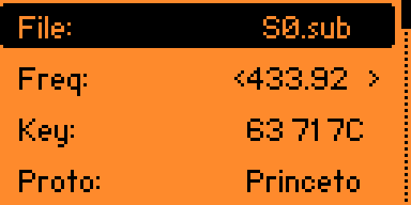
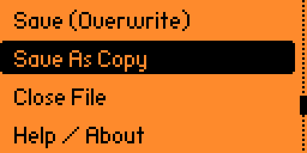
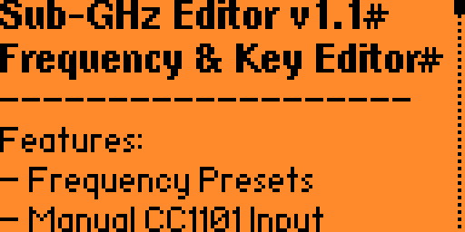

# Sub-GHz Editor for Flipper Zero

<p align="center">
  <br>
  <b>Sub-GHz File Frequency and Key Code Payload Editor</b><br>
  <i>Inspect • Adjust Frequency Presets • Manual Frequency Input • Hex Key Payload Editing</i>
</p>

<p align="center">
  
  
  
</p>

---

## 🎯 Overview

Normally on the Flipper Zero, modifying captured Sub-GHz `.sub` files requires taking out the micro SD card, connecting it to a computer, and editing text files manually.

**Sub-GHz Editor** brings direct, on-device inspection and modification of saved Sub-GHz transmission captures:
1. Open any captured or saved `.sub` file stored on your SD card.
2. Cycle through standard regional frequency presets or enter an arbitrary custom frequency with live hardware band validation.
3. Edit protocol transmission keys in hexadecimal directly using an interactive text editor.
4. Save modifications in-place or create a new backup copy (`_edit.sub`).

---

## ✨ Features

- **File Browser Integration**:
  - Direct file browser dialog to select any `.sub` file from `/ext/subghz`.
  - Seamless file launcher integration: opens `.sub` files directly from Flipper's native File Manager.
- **Standard Frequency Presets**:
  - Instant cycling across all common Sub-GHz frequencies:
    - `315.00 MHz`
    - `318.00 MHz`
    - `345.00 MHz`
    - `390.00 MHz`
    - `433.07 MHz`
    - `433.88 MHz`
    - `433.92 MHz`
    - `434.42 MHz`
    - `434.77 MHz`
    - `868.35 MHz`
    - `868.85 MHz`
    - `915.00 MHz`
- **Manual / Custom Frequency Input**:
  - Enter arbitrary target frequencies (in Hz or MHz).
  - Built-in hardware band verification adhering to CC1101 transceiver limits:
    - `300 MHz – 348 MHz`
    - `387 MHz – 464 MHz`
    - `779 MHz – 928 MHz`
- **HEX Key Code Editor**:
  - Modify protocol keys directly with live hexadecimal validation.
- **Safe Saving**:
  - **Overwrite**: Updates target file preserving header integrity and metadata.
  - **Save As Copy**: Saves a copy with `_edit.sub` suffix to prevent accidental overwrite of original captures.
- **Haptic & Acoustic Feedback**:
  - Distinct vibro and sound notifications on successful saves or invalid input.

---

## 🎮 Navigation & Controls

| Screen / Item | Button | Action |
|---|---|---|
| **Main Menu (No file)** | `[OK]` on "Open .sub File" | Launch file browser dialog |
| **Main Menu (No file)** | `[OK]` on "Help / About" | Show application info screen |
| **Editor** | `[<] / [>]` on "Freq" | Cycle standard frequency presets |
| **Editor** | `[OK]` on "Freq" | Open manual frequency input dialog |
| **Editor** | `[OK]` on "Key" | Open hexadecimal key editor |
| **Editor** | `[OK]` on "Save (Overwrite)" | Save changes to opened file |
| **Editor** | `[OK]` on "Save As Copy" | Save new copy with `_edit.sub` suffix |
| **Editor** | `[OK]` on "Close File" | Close current file and return to start |
| **Any View** | `[Back]` | Return to previous view or exit |

---

## 🛠️ Building & Installing

### Prerequisites
Install `ufbt` (micro Flipper Build Tool):
```bash
pip install ufbt
```

### Build `.fap` Package
```bash
cd flipper-subghz-editor
ufbt
```
The compiled package will be located at `dist/subghz_editor.fap`.

### Install to Flipper Zero
Connect your Flipper Zero via USB and run:
```bash
ufbt launch
```

---

## ☕ Support & Donations

If you find **Sub-GHz Editor** useful and would like to support future development, hardware experiments, and updates:

- **Bitcoin (BTC)**: `bc1q7fu5pck45x2v03e6yyqzf2hexu598s58c8zczg`

---

## 📜 License

MIT License. Created by Vazgen Grigoryan.
